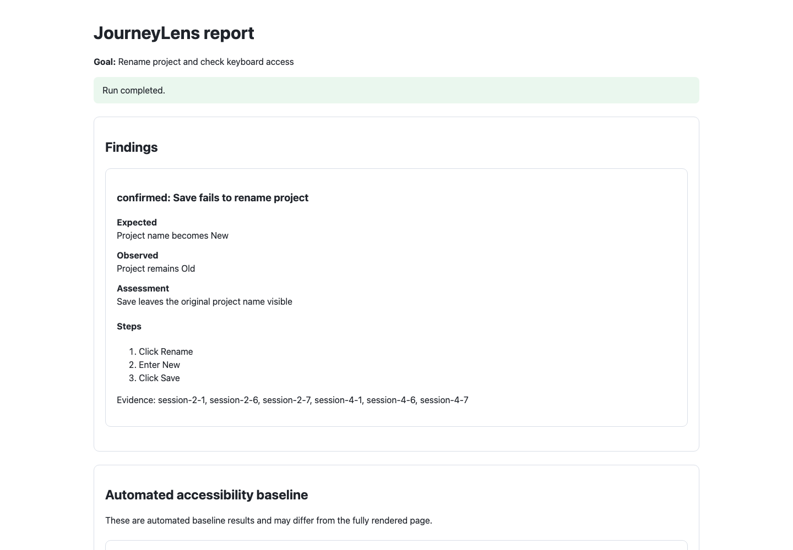
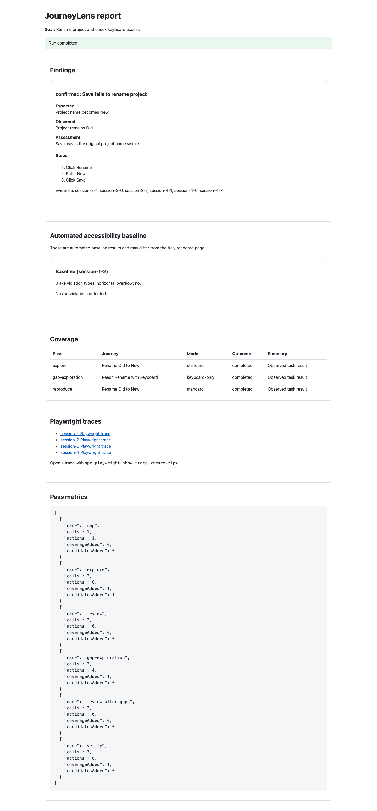

# JourneyLens

A single TypeScript Node.js application that uses Playwright and a chat-completions-compatible model endpoint. Node coordinates the workflow; Playwright launches browser child processes. No agent framework, job queue, or database.

## Start

Requires Node.js 22+ and npm.

```bash
npm ci
npx playwright install chromium
npm run demo
```

The demo starts a local deliberately broken rename form, runs the full pipeline using scripted model responses, and writes `runs/demo/report.html` plus JSON and Markdown reports. It exercises plumbing without credentials; it does **not** measure LLM accuracy.

### Sample report

These screenshots show the report for the local demo fixture, not a live or third-party website.



<details>
<summary>Full-page report screenshot</summary>



</details>

For an actual model-driven run, start your React preview server, then:

```bash
npm start -- --url http://localhost:3000 \
  --goal "Create a project, rename it, and check keyboard navigation"
```

By default, JourneyLens sends requests to `http://localhost:8080/v1/chat/completions` using model `openai/custom`. Override these with `LLM_ENDPOINT` (a full chat-completions URL) and `LLM_MODEL`. `LLM_API_KEY` is optional and can be omitted for local servers. The endpoint must support `messages`, JSON-object `response_format`, and text in `choices[0].message.content`. Provider-specific request differences belong in `src/model.ts`. Credentials are read from environment and not written into run configuration. `.env` files are not loaded automatically; Node's `--env-file` or your shell can load them.

Optional flags: `--out`, `--headed`, `--max-calls` (24), `--max-actions` (200), `--max-probes` (5 per journey), `--max-journeys` (3 per round), `--minutes` (10).

Use a new output directory per run; the default includes a timestamp.

## Pipeline

1. **Map + baseline:** Observe initial accessible structure, collect axe violations and horizontal overflow, propose prioritized journeys.
2. **Explore:** Fresh context per journey. Model generates disposable async JavaScript function bodies, executed with a small `ui` facade. Observations and errors return to the next model call.
3. **Independent review:** A fresh stateless request sees raw evidence before candidate conclusions. A second request compares its assessment to the candidates.
4. **Gap exploration:** At most one additional round, followed by another independent review.
5. **Reproduce:** Fresh context per non-rejected candidate, then a separate validity/reproduction judgment. Confirmed findings require existing evidence IDs from that reproduction attempt.
6. **Report:** Deterministic consolidation, coverage outcomes, per-pass calls/actions, and incomplete-run status.

Agreement and repeated behavior do not prove correctness. `confirmed` means agent-assessed validity plus reproduction evidence, not human verification. Inconclusive and untested states remain visible. Automated axe findings stay separate in the evidence record and are not silently converted into agent confirmations.

## Disposable probe API

Code is an async function **body**:

```js
await ui.click('button', 'Rename');
await ui.fill('textbox', 'Project name', 'New');
await ui.click('button', 'Save');
return await ui.observe();
```

Every method returns `{ evidenceId, value }` and is logged. Common methods: `observe()`, `screenshot()`, `press(key)`, `scroll(dy)`. Standard mode adds `click(role, name)` and `fill(role, name, text)`. Keyboard-only mode omits click/fill. Setup navigation happens before the probe. Semantic observations include URL, ARIA snapshot, current focus, and page errors. Screenshots are saved for human inspection; this initial model adapter is text-only.

## Files

- `src/main.ts`: CLI and argument validation
- `src/runner.ts`: passes, orchestration, budgets, checkpoints, reports
- `src/browser.ts`: sessions, actions, evidence, disposable code execution
- `src/model.ts`: model HTTP adapter, stateless requests and response validation
- `src/types.ts`: runtime schemas and shared records
- `src/demo.ts`: local fixture and scripted adapter

Run output includes `state.json`, `report.json`, `report.md`, `report.html`, `events.jsonl`, `probes/*.js`, `evidence/*.png`, and Playwright traces. The HTML report links to available trace archives. View traces with `npx playwright show-trace <path>`. Reports reference evidence IDs resolved in `state.json` or `events.jsonl`. If an LLM request times out, the run stops cleanly, saves partial reports, and records the pass and timeout in the report.

## Prototype boundaries

Generated code executes in-process using `node:vm`, which is **not a security sandbox**. Use only a disposable local test environment, trusted model endpoint, and non-production data. The restricted API is a testing convention, not a security boundary. Code must await all UI calls. Synchronous execution has a VM timeout; asynchronous probes have a 15-second timer that closes their browser context. A run deadline closes the browser, but in-process hostile asynchronous JavaScript cannot be reliably terminated. Strong isolation would require a different process architecture.

This version has no authentication bootstrap, arbitrary route navigation, visual model input, screen reader driver, network allowlist, CLS collection, exhaustive discovery, severity scoring, or automatic regression-test promotion. It can follow links exposed by the app. Fresh contexts reset cookies and browser storage, not server-side data. Long runs may exceed model context limits because review receives accumulated evidence. Traces and action logs may contain form data and page content; keep run artifacts private.

## Validation

```bash
npm run check
npm test
```

Integration tests run real Chromium against the local fixture with scripted model responses. They check the full pass sequence, gap exploration, fresh sessions, report generation, and refusal to confirm a finding backed only by invented evidence IDs. They do not validate a live model provider.

Validation completed locally with `npm run check`, `npm test` (3 tests passed), and `npm audit` (0 vulnerabilities). No live model-provider run was performed.
